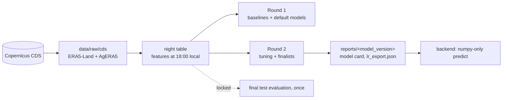

## Data and experiments (DVC + DagsHub)



The data is ERA5-Land and AgERA5 reanalysis (a weather model combined with assimilated observations), not raw satellite imagery, and the frost labels come from the same reanalysis.

**What lives where**

| in git | in DagsHub (DVC remote and MLflow) |
|---|---|
| code (`src/frostwatch_ml`, `pipelines/`, `tests/`, `tools/`), configs, docs, executed notebooks | raw CDS downloads (`dvc/raw_cds.dvc`) |
| `reports/`: validation tables, model cards, `lr_export.json`, thresholds, reliability bins, figures | `data/processed/`: night table, anomalies, cross-checks, validation predictions |
| `experiments/<run_id>/`: config and metrics of every run | `models/<model_version>/model.joblib` |
| `dvc.yaml`, `dvc.lock`, `.dvc/config` | MLflow runs: https://dagshub.com/SNARF3/altiplano-frost.mlflow (experiment "frostwatch-altiplano") |

DagsHub repository: https://dagshub.com/SNARF3/altiplano-frost

**Leakage controls** (checked by `make test`)

- Features use only hours up to 18:00 local (22:00 UTC) of the night; a test replaces every later value with noise and checks that no feature changes.
- Features are an explicit allowlist (`configs/features.yaml`); the label, identifiers and the AgERA5 cross-check columns can never be features.
- Cloud cover enters with a one-day lag (the AgERA5 daily mean includes hours after 18:00).
- Every fitted statistic (scaler, percentiles, climatology, calibration) uses training years (1985-2009) only; calibration uses a cross-validation grouped by year.
- Models, thresholds and hyperparameters are chosen on validation (2010-2017). The test years (2018-2025) are locked in code until a single final evaluation; 2026 is only an out-of-sample check.

**Reproduce**

```
python3.12 -m venv .venv
.venv/bin/pip install -r requirements.txt -r requirements-model.txt
.venv/bin/pip install -e .
dvc pull          # raw data, processed data and models from DagsHub
make test lint    # leakage and integrity tests, ruff
dvc repro         # rerun any stage whose code, config or inputs changed
```

Generated using Copernicus Climate Change Service information [2026].
