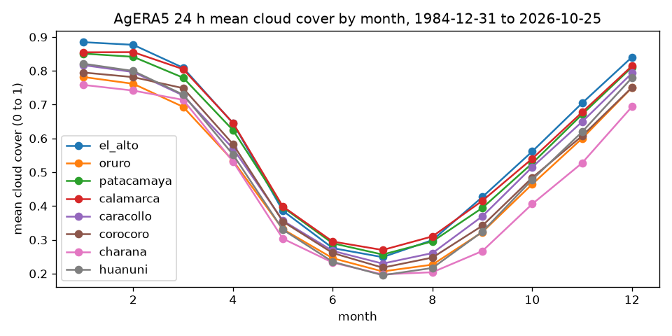
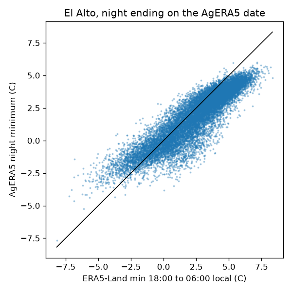

# EDA: AgERA5 daily series

Generated by `pipelines/02b_eda_agera5.py`. AgERA5 (`sis-agrometeorological-indicators-timeseries`, Copernicus CDS) is a daily product derived from the ERA5 reanalysis, with its own 0.1 degree grid. It is reanalysis, not raw satellite imagery. Cross-checks use rows up to 2025-12-31; 2026 is out of sample.

File source attribute: "AgERA5 daily weather variables derived from the ECMWF ERA5 reanalysis.", institution "Wageningen Environmental Research".

## Time convention
From the variable attributes of the downloaded files:

| variable | long_name | units | temporal_aggregation |
|---|---|---|---|
| Cloud_Cover_Mean_24h | Total cloud cover (00-00LT) | (0-1) | Mean 00-00LT |
| Temperature_Air_2m_Min_Night_Time | Minimum temperature at 2 meter (18-06LT) | K | Min 18-06LT |
| Relative_Humidity_2m_15h | Relative humidity at 15LT | % | 15LT |

`valid_time` holds the date at 00:00, and the aggregation windows are given in local time (LT). The night-time minimum of date D covers 18:00 local of D-1 to 06:00 local of D, that is, the night that ends on the morning of D. This is confirmed below: the correlation with the ERA5-Land minimum of the night ending on D is far higher than with the night starting on D. Consequences for the night table: the AgERA5 night minimum for night D (starting at 18:00 of D) is the value dated D+1, and only as a label cross-check; the 24 h cloud cover of date D covers the whole local day D, so night D only uses the value of D-1.

## Coverage, NaN, cloud range and grid offset
| point_id | first_date | last_date | days | expected_days | non_daily_steps | duplicates | nan_cloud_cover_24h | nan_tmin_night_k | nan_rh_15h | cloud_below_0 | cloud_above_1 | agera5_lat | agera5_lon | era5land_lat | era5land_lon | offset_km |
|---|---|---|---|---|---|---|---|---|---|---|---|---|---|---|---|---|
| el_alto | 1984-12-31 | 2026-10-25 | 15274 | 15274 | 0 | 0 | 0 | 0 | 0 | 0 | 0 | -16.500 | -68.200 | -16.500 | -68.200 | 0.000 |
| oruro | 1984-12-31 | 2026-10-25 | 15274 | 15274 | 0 | 0 | 0 | 0 | 0 | 0 | 0 | -18.000 | -67.100 | -18.000 | -67.100 | 0.000 |
| patacamaya | 1984-12-31 | 2026-10-25 | 15274 | 15274 | 0 | 0 | 0 | 0 | 0 | 0 | 0 | -17.200 | -67.900 | -17.200 | -67.900 | 0.000 |
| calamarca | 1984-12-31 | 2026-10-25 | 15274 | 15274 | 0 | 0 | 0 | 0 | 0 | 0 | 0 | -17.000 | -68.100 | -17.000 | -68.100 | 0.000 |
| caracollo | 1984-12-31 | 2026-10-25 | 15274 | 15274 | 0 | 0 | 0 | 0 | 0 | 0 | 0 | -17.600 | -67.200 | -17.600 | -67.200 | 0.000 |
| corocoro | 1984-12-31 | 2026-10-25 | 15274 | 15274 | 0 | 0 | 0 | 0 | 0 | 0 | 0 | -17.200 | -69.100 | -17.200 | -69.100 | 0.000 |
| charana | 1984-12-31 | 2026-10-25 | 15274 | 15274 | 0 | 0 | 0 | 0 | 0 | 0 | 0 | -17.600 | -69.400 | -17.600 | -69.400 | 0.000 |
| huanuni | 1984-12-31 | 2026-10-25 | 15274 | 15274 | 0 | 0 | 0 | 0 | 0 | 0 | 0 | -18.300 | -66.800 | -18.300 | -66.800 | 0.000 |

offset_km is the great-circle distance between the AgERA5 point returned for the city coordinates and the ERA5-Land cell used for the same point.

## Cloud cover seasonal cycle (mean by month)
| month | el_alto | oruro | patacamaya | calamarca | caracollo | corocoro | charana | huanuni |
|---|---|---|---|---|---|---|---|---|
| 1 | 0.885 | 0.782 | 0.851 | 0.855 | 0.817 | 0.795 | 0.758 | 0.821 |
| 2 | 0.877 | 0.762 | 0.841 | 0.855 | 0.796 | 0.781 | 0.742 | 0.800 |
| 3 | 0.809 | 0.693 | 0.780 | 0.805 | 0.727 | 0.749 | 0.714 | 0.730 |
| 4 | 0.645 | 0.534 | 0.624 | 0.646 | 0.570 | 0.583 | 0.532 | 0.552 |
| 5 | 0.386 | 0.331 | 0.396 | 0.398 | 0.357 | 0.354 | 0.303 | 0.330 |
| 6 | 0.275 | 0.246 | 0.290 | 0.295 | 0.267 | 0.261 | 0.232 | 0.235 |
| 7 | 0.249 | 0.206 | 0.256 | 0.270 | 0.230 | 0.218 | 0.198 | 0.195 |
| 8 | 0.299 | 0.227 | 0.295 | 0.310 | 0.261 | 0.247 | 0.204 | 0.217 |
| 9 | 0.427 | 0.323 | 0.394 | 0.415 | 0.370 | 0.342 | 0.267 | 0.324 |
| 10 | 0.561 | 0.465 | 0.526 | 0.540 | 0.515 | 0.484 | 0.406 | 0.478 |
| 11 | 0.704 | 0.600 | 0.671 | 0.677 | 0.649 | 0.607 | 0.527 | 0.619 |
| 12 | 0.841 | 0.750 | 0.811 | 0.814 | 0.793 | 0.751 | 0.694 | 0.779 |

## Cross-checks against ERA5-Land
- Night minimum: AgERA5 night-time minimum vs the minimum of hourly ERA5-Land t2m over 18:00 to 06:00 local (13 values). Bias and MAE are AgERA5 minus ERA5-Land, for the night ending on the AgERA5 date. Frost-flag agreement: share of nights where both are at or below 0 C or both are above.
- RH: AgERA5 relative humidity at 15:00 local vs RH from ERA5-Land t2m and d2m at 19:00 UTC (Magnus, coefficients 17.62 and 243.12 C). Bias in percentage points.

| point_id | n_days | tmin_corr_night_ending | tmin_corr_night_starting | tmin_bias_c | tmin_mae_c | frost_flag_agreement | frost_rate_agera5 | frost_rate_era5land | rh_corr | rh_bias_pct | rh_mae_pct |
|---|---|---|---|---|---|---|---|---|---|---|---|
| el_alto | 14974 | 0.903 | 0.805 | -0.560 | 0.982 | 0.900 | 0.224 | 0.177 | 0.883 | -8.234 | 10.550 |
| oruro | 14974 | 0.939 | 0.846 | 0.095 | 0.844 | 0.907 | 0.221 | 0.199 | 0.962 | -2.195 | 5.325 |
| patacamaya | 14974 | 0.923 | 0.814 | 0.016 | 0.956 | 0.907 | 0.336 | 0.337 | 0.932 | 5.017 | 7.055 |
| calamarca | 14974 | 0.941 | 0.820 | -0.309 | 0.931 | 0.917 | 0.376 | 0.352 | 0.915 | 4.141 | 7.285 |
| caracollo | 14974 | 0.928 | 0.823 | -0.207 | 0.983 | 0.921 | 0.206 | 0.215 | 0.956 | -4.692 | 7.189 |
| corocoro | 14974 | 0.953 | 0.830 | 1.202 | 1.730 | 0.880 | 0.395 | 0.491 | 0.965 | 3.390 | 5.249 |
| charana | 14974 | 0.915 | 0.785 | 1.351 | 1.805 | 0.873 | 0.549 | 0.627 | 0.957 | 1.368 | 5.625 |
| huanuni | 14974 | 0.913 | 0.808 | -0.624 | 1.009 | 0.889 | 0.420 | 0.361 | 0.964 | 1.717 | 5.835 |

Both products come from the ERA5 family, so agreement here is a consistency check, not an independent validation.
