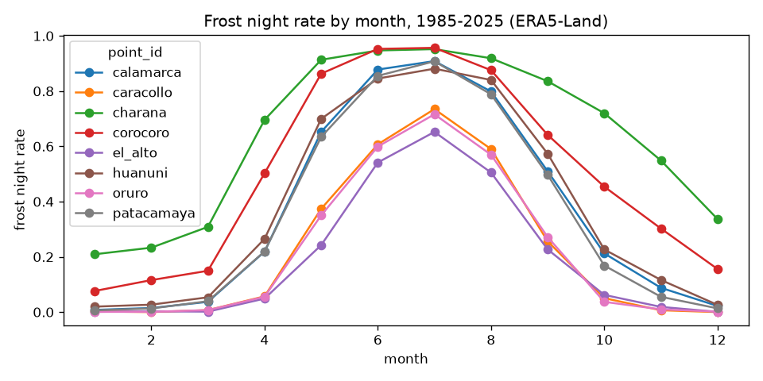
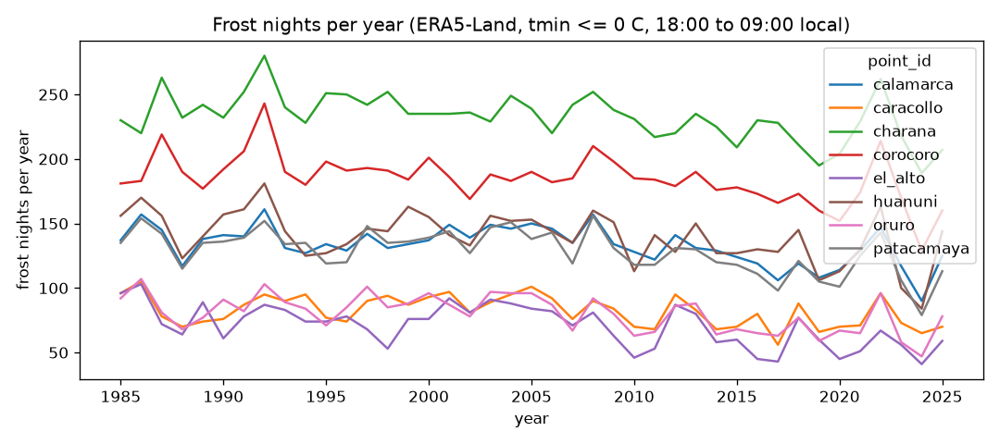

# EDA: ERA5-Land hourly series

Generated by `pipelines/02a_eda_era5land.py`. Data: ERA5-Land reanalysis (Copernicus CDS), not raw satellite imagery. The frost label is computed from the same reanalysis, so it describes frost on the 0.1 degree grid, not at a station.

Inputs: 8 cells, main file 1985-01-01 to 2025-12-31 plus the 2026 file up to 2026-10-26 (out-of-sample check), read from the zip archives listed in the manifest.

## Units
t2m, d2m, skt, stl1: K to C. sp: Pa to hPa. ssrd, strd: J m-2 accumulated over the hour ending at the timestamp, divided by 3600 to W m-2. tp: m to mm per hour. Wind speed = sqrt(u10^2 + v10^2) in m s-1.

## Coverage, gaps and duplicates
| point_id | first_utc | last_utc | hours | expected_hours | missing_hours | duplicate_timestamps | non_hourly_steps | grid_lat | grid_lon | mean_sp_hpa |
|---|---|---|---|---|---|---|---|---|---|---|
| el_alto | 1985-01-01 00:00:00 | 2026-10-26 23:00:00 | 366576 | 366576 | 0 | 0 | 0 | -16.50 | -68.20 | 638.28 |
| oruro | 1985-01-01 00:00:00 | 2026-10-26 23:00:00 | 366576 | 366576 | 0 | 0 | 0 | -18.00 | -67.10 | 647.85 |
| patacamaya | 1985-01-01 00:00:00 | 2026-10-26 23:00:00 | 366576 | 366576 | 0 | 0 | 0 | -17.20 | -67.90 | 627.09 |
| calamarca | 1985-01-01 00:00:00 | 2026-10-26 23:00:00 | 366576 | 366576 | 0 | 0 | 0 | -17.00 | -68.10 | 629.43 |
| caracollo | 1985-01-01 00:00:00 | 2026-10-26 23:00:00 | 366576 | 366576 | 0 | 0 | 0 | -17.60 | -67.20 | 641.65 |
| corocoro | 1985-01-01 00:00:00 | 2026-10-26 23:00:00 | 366576 | 366576 | 0 | 0 | 0 | -17.20 | -69.10 | 630.85 |
| charana | 1985-01-01 00:00:00 | 2026-10-26 23:00:00 | 366576 | 366576 | 0 | 0 | 0 | -17.60 | -69.40 | 622.25 |
| huanuni | 1985-01-01 00:00:00 | 2026-10-26 23:00:00 | 366576 | 366576 | 0 | 0 | 0 | -18.30 | -66.80 | 616.45 |

## NaN per variable
| point_id | nan_t2m | nan_d2m | nan_sp | nan_tp | nan_ssrd | nan_strd | nan_skt | nan_stl1 | nan_u10 | nan_v10 |
|---|---|---|---|---|---|---|---|---|---|---|
| el_alto | 0 | 0 | 0 | 0 | 0 | 0 | 0 | 0 | 0 | 0 |
| oruro | 0 | 0 | 0 | 0 | 0 | 0 | 0 | 0 | 0 | 0 |
| patacamaya | 0 | 0 | 0 | 0 | 0 | 0 | 0 | 0 | 0 | 0 |
| calamarca | 0 | 0 | 0 | 0 | 0 | 0 | 0 | 0 | 0 | 0 |
| caracollo | 0 | 0 | 0 | 0 | 0 | 0 | 0 | 0 | 0 | 0 |
| corocoro | 0 | 0 | 0 | 0 | 0 | 0 | 0 | 0 | 0 | 0 |
| charana | 0 | 0 | 0 | 0 | 0 | 0 | 0 | 0 | 0 | 0 |
| huanuni | 0 | 0 | 0 | 0 | 0 | 0 | 0 | 0 | 0 | 0 |

## Value ranges after conversion (min / max per cell)
Minimum:

| field | calamarca | caracollo | charana | corocoro | el_alto | huanuni | oruro | patacamaya |
|---|---|---|---|---|---|---|---|---|
| d2m_c | -46.66 | -47.89 | -47.77 | -43.78 | -45.01 | -49.34 | -42.88 | -48.12 |
| skt_c | -20.35 | -28.66 | -33.40 | -21.87 | -19.82 | -28.65 | -24.52 | -25.14 |
| sp_hpa | 621.65 | 631.79 | 615.97 | 623.90 | 631.63 | 609.62 | 640.33 | 620.55 |
| ssrd_wm2 | -0.00 | -0.00 | -0.00 | -0.00 | -0.00 | -0.00 | -0.00 | -0.00 |
| stl1_c | -7.60 | -2.28 | -9.55 | -2.27 | -5.42 | -10.84 | -4.86 | -2.44 |
| strd_wm2 | 124.73 | 132.45 | 112.55 | 134.85 | 118.98 | 131.66 | 120.62 | 125.73 |
| t2m_c | -12.58 | -8.13 | -23.50 | -19.57 | -8.47 | -13.90 | -8.68 | -10.15 |
| tp_mm | -0.00 | -0.00 | -0.00 | -0.00 | -0.00 | -0.00 | -0.00 | -0.00 |
| u10 | -5.87 | -8.05 | -8.15 | -7.64 | -6.00 | -7.79 | -9.45 | -5.20 |
| v10 | -7.06 | -10.17 | -7.28 | -10.23 | -6.22 | -9.68 | -11.64 | -7.22 |
| wind_ms | 0.00 | 0.00 | 0.00 | 0.00 | 0.00 | 0.01 | 0.01 | 0.01 |

Maximum:

| field | calamarca | caracollo | charana | corocoro | el_alto | huanuni | oruro | patacamaya |
|---|---|---|---|---|---|---|---|---|
| d2m_c | 10.47 | 15.13 | 13.96 | 10.18 | 13.17 | 12.60 | 11.14 | 8.61 |
| skt_c | 48.50 | 51.90 | 50.86 | 48.23 | 45.46 | 53.26 | 50.64 | 48.66 |
| sp_hpa | 635.31 | 647.99 | 629.06 | 636.84 | 645.67 | 622.27 | 654.61 | 633.04 |
| ssrd_wm2 | 1268.68 | 1279.03 | 1276.11 | 1258.46 | 1220.17 | 1261.42 | 1262.36 | 1252.48 |
| stl1_c | 39.26 | 42.34 | 40.34 | 38.80 | 37.67 | 44.02 | 41.09 | 39.25 |
| strd_wm2 | 369.44 | 355.37 | 353.14 | 355.09 | 365.11 | 355.97 | 357.31 | 368.39 |
| t2m_c | 21.50 | 22.17 | 21.69 | 22.81 | 19.46 | 21.00 | 23.74 | 21.33 |
| tp_mm | 7.03 | 15.01 | 5.33 | 4.65 | 6.41 | 10.16 | 7.46 | 4.89 |
| u10 | 7.74 | 12.96 | 12.40 | 11.42 | 9.78 | 12.39 | 13.34 | 8.74 |
| v10 | 4.98 | 8.03 | 7.33 | 8.00 | 5.73 | 6.68 | 7.74 | 5.77 |
| wind_ms | 8.62 | 12.97 | 12.69 | 11.50 | 10.42 | 12.63 | 14.05 | 8.75 |

## Anomaly rules
- dewpoint_above_temperature: d2m > t2m + 0.1 C.
- wind_negative: wind speed < 0 (cannot happen by construction, checked anyway).
- ssrd_negative, precipitation_negative: value < 0.
- ssrd_at_night: ssrd > 1.0 W m-2 for hours ending at [1, 2, 3, 4, 5, 6, 7, 8, 9] UTC (21:00 to 05:00 local).
- strd_out_of_range: strd outside [50.0, 550.0] W m-2.
- sp_far_from_cell_median: |sp - cell median| > 20.0 hPa.
- hourly_jump: absolute change between consecutive hours above {'t2m_c': 8.0, 'd2m_c': 10.0, 'skt_c': 15.0, 'sp_hpa': 5.0}.
- stuck_value: the same value for at least 6 consecutive hours in ['t2m_c', 'd2m_c', 'sp_hpa', 'skt_c', 'stl1_c', 'strd_wm2', 'u10', 'v10'] (one row per hour of the run).

These thresholds are screening choices declared in `configs/frost.yaml`, not physical constants. Flags are listed with exact positions in `data/processed/anomalies.parquet`; nothing is fixed or dropped.

### Counts by rule and field
| rule | field | count |
|---|---|---|
| hourly_jump | d2m_c | 3818 |
| hourly_jump | skt_c | 1 |
| hourly_jump | t2m_c | 218 |
| precipitation_negative | tp_mm | 38321 |
| ssrd_negative | ssrd_wm2 | 802 |

### Counts by rule and cell
| rule | calamarca | caracollo | charana | corocoro | el_alto | huanuni | oruro | patacamaya |
|---|---|---|---|---|---|---|---|---|
| hourly_jump | 546 | 979 | 259 | 221 | 95 | 1696 | 215 | 26 |
| precipitation_negative | 4403 | 4879 | 5290 | 5112 | 3634 | 5229 | 5434 | 4340 |
| ssrd_negative | 107 | 101 | 81 | 91 | 83 | 142 | 105 | 92 |

Most negative values flagged by the negative-value rules (de-accumulation rounding is the likely cause when they are tiny):

| rule | min_value |
|---|---|
| precipitation_negative | -0.00005961 |
| ssrd_negative | -0.00111111 |

## Frost frequency (nights of 1985-2025)
Frost night: minimum hourly t2m from 18:00 local of day D to 09:00 local of day D+1 (22:00 UTC to 13:00 UTC, 16 values) at or below 0 C.

| point_id | nights | frost_rate | mean_tmin_c |
|---|---|---|---|
| calamarca | 14975 | 0.364 | 0.893 |
| caracollo | 14975 | 0.225 | 2.595 |
| charana | 14975 | 0.637 | -1.806 |
| corocoro | 14975 | 0.506 | -0.579 |
| el_alto | 14975 | 0.193 | 2.337 |
| huanuni | 14975 | 0.383 | 0.788 |
| oruro | 14975 | 0.220 | 2.747 |
| patacamaya | 14975 | 0.352 | 1.011 |

### By month
| month | calamarca | caracollo | charana | corocoro | el_alto | huanuni | oruro | patacamaya |
|---|---|---|---|---|---|---|---|---|
| 1 | 0.008 | 0.002 | 0.209 | 0.076 | 0.001 | 0.020 | 0.001 | 0.006 |
| 2 | 0.015 | 0.000 | 0.233 | 0.116 | 0.003 | 0.027 | 0.001 | 0.013 |
| 3 | 0.037 | 0.007 | 0.308 | 0.149 | 0.002 | 0.054 | 0.007 | 0.039 |
| 4 | 0.219 | 0.057 | 0.696 | 0.502 | 0.049 | 0.265 | 0.055 | 0.220 |
| 5 | 0.652 | 0.374 | 0.913 | 0.863 | 0.242 | 0.699 | 0.350 | 0.634 |
| 6 | 0.878 | 0.607 | 0.947 | 0.953 | 0.541 | 0.846 | 0.599 | 0.855 |
| 7 | 0.909 | 0.735 | 0.952 | 0.957 | 0.652 | 0.881 | 0.716 | 0.908 |
| 8 | 0.799 | 0.590 | 0.919 | 0.876 | 0.505 | 0.840 | 0.570 | 0.788 |
| 9 | 0.510 | 0.256 | 0.836 | 0.641 | 0.227 | 0.573 | 0.272 | 0.497 |
| 10 | 0.212 | 0.050 | 0.720 | 0.454 | 0.062 | 0.227 | 0.037 | 0.168 |
| 11 | 0.088 | 0.007 | 0.549 | 0.302 | 0.019 | 0.116 | 0.010 | 0.055 |
| 12 | 0.022 | 0.000 | 0.337 | 0.156 | 0.001 | 0.026 | 0.002 | 0.013 |

## Trends 1985-2025
Ordinary least squares slope of the annual count of frost nights and of the annual mean night minimum, per decade, plus the mean annual frost nights in the first and last 10 years.

| point_id | frost_nights_per_decade | mean_tmin_c_per_decade | frost_nights_1985_1994_mean | frost_nights_2016_2025_mean |
|---|---|---|---|---|
| calamarca | -6.46 | 0.21 | 139.40 | 117.40 |
| caracollo | -4.32 | 0.14 | 86.60 | 73.50 |
| charana | -8.34 | 0.35 | 241.90 | 217.30 |
| corocoro | -8.44 | 0.35 | 196.10 | 167.10 |
| el_alto | -8.05 | 0.20 | 80.70 | 54.40 |
| huanuni | -8.38 | 0.19 | 151.30 | 124.30 |
| oruro | -6.55 | 0.18 | 87.40 | 67.50 |
| patacamaya | -8.22 | 0.23 | 137.70 | 110.20 |

A trend means the chronological split (train 1985-2009, validation 2010-2017, test 2018-2025) sees different base rates in each split. No confidence intervals are computed.
