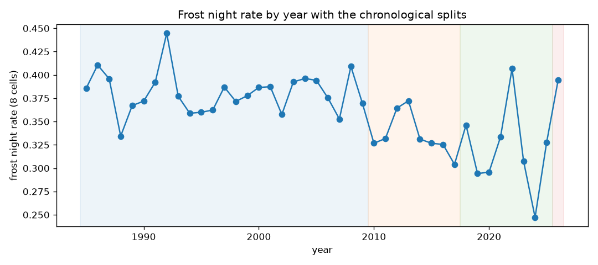
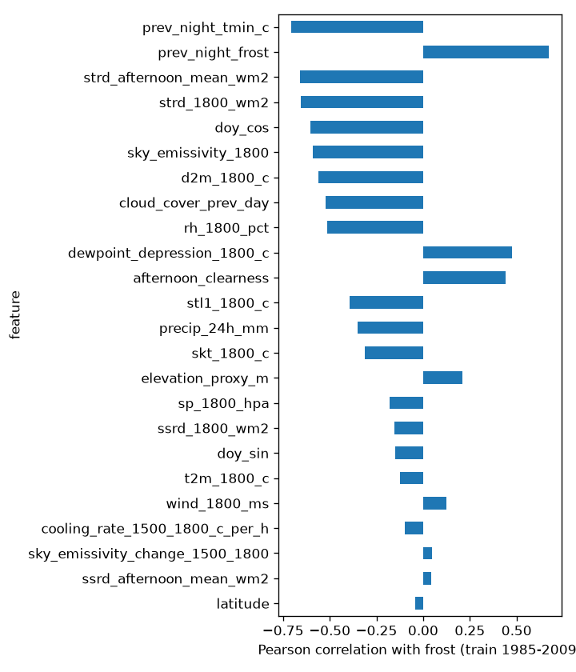

# EDA: night table

Generated by `pipelines/03b_eda_merged.py` from `data/processed/features.parquet`. One row per cell and night D (local date of the 18:00 snapshot). Labels come from the same ERA5-Land reanalysis as the features (grid frost, not station frost).

## Class balance by split
majority_class_accuracy is the accuracy of always predicting the most frequent class; any model must beat it.

| split | rows | frost_nights | frost_rate | majority_class_accuracy |
|---|---|---|---|---|
| train | 73040 | 27808.0000 | 0.3807 | 0.6193 |
| validation | 23376 | 7839.0000 | 0.3353 | 0.6647 |
| test | 23376 | 7476.0000 | 0.3198 | 0.6802 |
| out_of_sample_check | 2384 | 940.0000 | 0.3943 | 0.6057 |

The out_of_sample_check rows (2026) are reported for information only; they never enter training, validation, test or any training statistic.

### Frost rate by cell and split
| point_id | train | validation | test | out_of_sample_check |
|---|---|---|---|---|
| calamarca | 0.384 | 0.342 | 0.325 | 0.413 |
| caracollo | 0.239 | 0.202 | 0.205 | 0.279 |
| charana | 0.660 | 0.614 | 0.587 | 0.674 |
| corocoro | 0.527 | 0.490 | 0.456 | 0.527 |
| el_alto | 0.215 | 0.162 | 0.156 | 0.215 |
| huanuni | 0.406 | 0.357 | 0.337 | 0.440 |
| oruro | 0.239 | 0.193 | 0.187 | 0.235 |
| patacamaya | 0.376 | 0.323 | 0.306 | 0.372 |

### Frost rate by month (train)
| month | calamarca | caracollo | charana | corocoro | el_alto | huanuni | oruro | patacamaya |
|---|---|---|---|---|---|---|---|---|
| 1 | 0.006 | 0.003 | 0.225 | 0.079 | 0.000 | 0.016 | 0.001 | 0.005 |
| 2 | 0.021 | 0.000 | 0.282 | 0.146 | 0.004 | 0.035 | 0.001 | 0.016 |
| 3 | 0.039 | 0.008 | 0.328 | 0.169 | 0.001 | 0.065 | 0.008 | 0.044 |
| 4 | 0.223 | 0.059 | 0.720 | 0.513 | 0.059 | 0.269 | 0.053 | 0.233 |
| 5 | 0.693 | 0.399 | 0.920 | 0.885 | 0.288 | 0.737 | 0.390 | 0.676 |
| 6 | 0.915 | 0.661 | 0.953 | 0.956 | 0.609 | 0.884 | 0.661 | 0.904 |
| 7 | 0.939 | 0.764 | 0.952 | 0.970 | 0.708 | 0.920 | 0.772 | 0.945 |
| 8 | 0.817 | 0.618 | 0.919 | 0.871 | 0.542 | 0.852 | 0.601 | 0.822 |
| 9 | 0.559 | 0.277 | 0.876 | 0.709 | 0.260 | 0.656 | 0.303 | 0.561 |
| 10 | 0.244 | 0.054 | 0.757 | 0.488 | 0.071 | 0.252 | 0.039 | 0.194 |
| 11 | 0.103 | 0.011 | 0.588 | 0.323 | 0.024 | 0.132 | 0.015 | 0.069 |
| 12 | 0.026 | 0.000 | 0.379 | 0.191 | 0.000 | 0.032 | 0.003 | 0.015 |

## Missing values
|  | train | validation | test | out_of_sample_check |
|---|---|---|---|---|
| frost | 0 | 0 | 0 | 8 |
| tmin_c | 0 | 0 | 0 | 8 |

## Drift by split
Mean of each split minus the training mean, divided by the training standard deviation.

| feature | train | validation | test | out_of_sample_check |
|---|---|---|---|---|
| t2m_1800_c | 0.000 | 0.167 | 0.305 | 0.367 |
| d2m_1800_c | 0.000 | 0.040 | 0.013 | -0.172 |
| dewpoint_depression_1800_c | 0.000 | 0.004 | 0.062 | 0.243 |
| rh_1800_pct | 0.000 | -0.011 | -0.064 | -0.245 |
| wind_1800_ms | 0.000 | 0.047 | 0.038 | 0.084 |
| sp_1800_hpa | 0.000 | 0.054 | 0.106 | 0.111 |
| ssrd_1800_wm2 | 0.000 | -0.012 | 0.008 | -0.011 |
| strd_1800_wm2 | 0.000 | 0.073 | 0.083 | -0.101 |
| ssrd_afternoon_mean_wm2 | 0.000 | -0.022 | -0.013 | 0.035 |
| strd_afternoon_mean_wm2 | 0.000 | 0.072 | 0.090 | -0.100 |
| skt_1800_c | 0.000 | 0.100 | 0.239 | 0.131 |
| stl1_1800_c | 0.000 | 0.114 | 0.250 | 0.107 |
| precip_24h_mm | 0.000 | 0.000 | -0.011 | -0.135 |
| prev_night_tmin_c | 0.000 | 0.115 | 0.179 | 0.009 |
| prev_night_frost | 0.000 | -0.093 | -0.125 | 0.027 |
| cooling_rate_1500_1800_c_per_h | 0.000 | 0.003 | 0.027 | 0.004 |
| doy_sin | 0.000 | 0.000 | 0.000 | 0.163 |
| doy_cos | 0.000 | 0.000 | 0.000 | -0.254 |
| latitude | 0.000 | 0.000 | 0.000 | 0.000 |
| elevation_proxy_m | 0.000 | 0.000 | 0.000 | 0.000 |
| sky_emissivity_1800 | 0.000 | 0.031 | 0.007 | -0.178 |
| sky_emissivity_change_1500_1800 | 0.000 | -0.001 | -0.014 | 0.027 |
| afternoon_clearness | 0.000 | -0.024 | -0.011 | 0.211 |
| cloud_cover_prev_day | 0.000 | 0.017 | -0.033 | -0.328 |

## Correlation with the label (training years only)
| feature | corr_with_frost_train |
|---|---|
| prev_night_tmin_c | -0.705 |
| prev_night_frost | 0.672 |
| strd_afternoon_mean_wm2 | -0.660 |
| strd_1800_wm2 | -0.654 |
| doy_cos | -0.605 |
| sky_emissivity_1800 | -0.592 |
| d2m_1800_c | -0.562 |
| cloud_cover_prev_day | -0.523 |
| rh_1800_pct | -0.514 |
| dewpoint_depression_1800_c | 0.476 |
| afternoon_clearness | 0.440 |
| stl1_1800_c | -0.393 |
| precip_24h_mm | -0.352 |
| skt_1800_c | -0.310 |
| elevation_proxy_m | 0.212 |
| sp_1800_hpa | -0.182 |
| ssrd_1800_wm2 | -0.156 |
| doy_sin | -0.148 |
| t2m_1800_c | -0.124 |
| wind_1800_ms | 0.124 |
| cooling_rate_1500_1800_c_per_h | -0.098 |
| sky_emissivity_change_1500_1800 | 0.046 |
| ssrd_afternoon_mean_wm2 | 0.044 |
| latitude | -0.041 |

## Sign check: cloud_cover_prev_day vs sky_emissivity_1800
Pearson correlation on training rows: 0.6763 (positive, as expected). A cloudier previous day should go with a more emissive sky at 18:00 on average; a negative sign would point to a date misalignment.

| point_id | corr_train |
|---|---|
| calamarca | 0.670 |
| caracollo | 0.661 |
| charana | 0.732 |
| corocoro | 0.686 |
| el_alto | 0.657 |
| huanuni | 0.680 |
| oruro | 0.655 |
| patacamaya | 0.678 |

## Label vs AgERA5 night minimum (train, validation and test nights)
The AgERA5 night-time minimum for night D is the value dated D+1 (18:00 local of D to 06:00 local of D+1). It is a cross-check only, never a feature. The window is 3 hours shorter than the label window (which ends at 09:00 local), and the products differ, so perfect agreement is not expected.

| point_id | nights | agreement | label_frost_rate | agera5_frost_rate | corr_tmin |
|---|---|---|---|---|---|
| calamarca | 14974 | 0.920 | 0.364 | 0.376 | 0.942 |
| caracollo | 14974 | 0.919 | 0.225 | 0.206 | 0.932 |
| charana | 14974 | 0.872 | 0.637 | 0.549 | 0.920 |
| corocoro | 14974 | 0.877 | 0.506 | 0.395 | 0.959 |
| el_alto | 14974 | 0.904 | 0.193 | 0.224 | 0.911 |
| huanuni | 14974 | 0.901 | 0.383 | 0.420 | 0.917 |
| oruro | 14974 | 0.908 | 0.220 | 0.221 | 0.943 |
| patacamaya | 14974 | 0.909 | 0.352 | 0.336 | 0.924 |

Overall agreement: 0.9012. Confusion (rows: label, columns: AgERA5 frost flag):

| label_frost | 0 | 1 |
|---|---|---|
| 0 | 71899 | 4770 |
| 1 | 7061 | 36062 |

## Limitations
- Labels are computed from the same reanalysis as the features: the model predicts grid frost, which is smoother than frost at a station or in a cold hollow.
- ERA5-Land cells are 0.1 degree (about 9 km). Local terrain, cold air pooling and crop-level temperatures are not resolved.
- AgERA5 is a different product with its own 0.1 degree grid. For these 8 points the returned AgERA5 point coincides with the ERA5-Land cell, but in general it can be offset by up to about 7 km.
- The cloud proxy is lagged: cloud_cover_prev_day is the mean of the previous local day, because the same-day value includes hours after 18:00.
- Frost rates trend down over 1985-2025, so the chronological splits have different base rates.
- No confidence intervals are computed.
