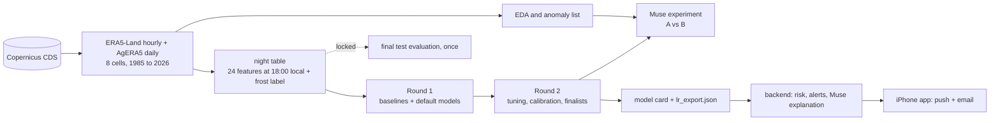

# FrostWatch Altiplano

Frost early warning for the Bolivian Altiplano (La Paz to Oruro corridor). A reproducible machine learning pipeline predicts, at 18:00 local time, whether the coming night will have frost in 8 areas. A mobile app (iPhone, Expo Go) delivers email and in-app alerts with a plain-language explanation written by Meta's Muse Spark. Alerts cover crops, livestock, water pipes, vehicles, road ice and property.

Built for the Meta Global AI Developer Hackathon (Indie track, "Build for Your World").

**Status:** all metrics below are validation results (2010-2017). The test years (2018-2025) are locked and will be evaluated once, at the end.

## Why

Radiation frost on clear, calm, dry nights damages crops and harms livestock across the Altiplano, freezes water pipes and leaves ice on roads. Frost nights are frequent but uneven: in the training years, the frost rate ranges from 0.215 (El Alto) to 0.660 (Charana) of all nights, depending on the cell. A warning at 18:00 gives people time to protect what they can.

## How it works



1. **Data:** hourly ERA5-Land reanalysis and daily AgERA5 for 8 ERA5-Land cells (El Alto, Oruro, Patacamaya, Calamarca, Caracollo, Corocoro, Charana, Huanuni), 1985 to October 2026, all from the Copernicus Climate Data Store.
2. **Night table:** one row per cell and night. It has 24 allowlisted features read at or before 18:00 local, such as temperature, dew point, humidity, wind, radiation, sky emissivity, soil temperature, the previous night's minimum and the previous day's cloud cover. The label is frost = 1 if the minimum 2 m temperature from 18:00 to 09:00 local is at or below 0 C.
3. **Chronological split by whole years:** train 1985-2009 (73,040 nights), validation 2010-2017 (23,376), test 2018-2025 (23,376, locked). 2026 is only an out-of-sample check and a source of nights for the demo replay.
4. **Models:** baselines, then logistic regression and tree models compared on validation. The production model is a logistic regression: cheap, interpretable and runnable with numpy only.
5. **Serving:** for each processed night, the backend computes the frost probability per area, compares it with the threshold fixed on validation and with the user's threshold (30, 50 or 70 percent), and sends one alert per area per night by email and Expo push. Muse Spark writes the explanation, and every number in it is checked against the model output, with a template fallback.

There is no live forecast yet. CDS reanalysis is published a few days late, so a night is processed either as a **replay** of a held-out test night with a simulated clock (the demo) or as a **manual tick** for a chosen date. Alerts are generated when a night is processed. They are not real time.

## Results so far (validation 2010-2017, 23,376 nights)

Pooled over the 8 cells. The majority-class accuracy is 0.6647.

| model | role | PR-AUC | F2 | precision | recall | ROC-AUC | Brier | accuracy |
|---|---|---|---|---|---|---|---|---|
| persistence (frost last night) | baseline | 0.6573 | 0.7594 | 0.7593 | 0.7594 | 0.8190 | 0.1614 | 0.8386 |
| climatology (same cell, +-7 days) | best baseline | 0.8135 | 0.8470 | 0.5869 | 0.9525 | 0.9078 | 0.1195 | 0.7593 |
| **LR_best** (logistic regression, C=1, L1, calibrated) | **production** | **0.8918** | **0.8757** | 0.6525 | 0.9576 | 0.9426 | 0.0913 | 0.8148 |
| TREE_best (LightGBM) | comparison only | 0.9105 | 0.8819 | 0.6631 | 0.9612 | 0.9512 | 0.0847 | 0.8232 |
| Muse condition B (LR on the Muse-improved data) | experiment, not adopted | 0.8924 | 0.8769 | 0.6626 | 0.9541 | 0.9435 | 0.0905 | 0.8217 |

- LR_best beats the best baseline by +0.078 PR-AUC and +0.029 F2 (pooled). The macro-average over cells is PR-AUC 0.8374 and F2 0.8570.
- LightGBM is slightly better (PR-AUC +0.019, F2 +0.006), but by project rule the logistic regression is the production model. It is interpretable, well calibrated and needs no model binary at serving time. Tree models are reported for comparison only.
- The strongest drivers of LR_best (standardized coefficients) are evening longwave radiation and sky emissivity (cloud and moisture), relative humidity, season and the previous night's minimum.
- Frost nights trend down over time. The frost rate is 0.381 in train, 0.335 in validation and 0.320 in test, so the base rate shifts between splits.
- No confidence intervals are computed. Small differences between models may be noise.

Full tables (pooled, per cell, macro, skill vs baselines): `docs/model_round1.md`, `docs/model_round2.md`, `reports/`.

### Metrics in one sentence

- **PR-AUC** (decision metric): average precision over all thresholds. Its chance level is the frost rate, so it is informative for rare events.
- **F2** (decision metric): like F1 but weights recall four times more than precision, because a missed frost costs more than a false alarm.
- **Precision:** of the nights flagged as frost, the share that had frost.
- **Recall:** of the nights with frost, the share that was flagged.
- **F1:** harmonic mean of precision and recall.
- **ROC-AUC:** probability that a random frost night gets a higher score than a random non-frost night (0.5 is chance).
- **Brier score:** mean squared error of the predicted probability (lower is better).
- **Accuracy:** share of nights classified correctly. It is misleading alone, so it is always shown next to the accuracy of always predicting the majority class.

## The Muse experiment (A vs B)

Can Meta's Muse Spark, acting as a data analyst, improve the dataset and with it the same logistic regression? Full write-up: [docs/MuseExperiment.md](docs/MuseExperiment.md).

- **A:** LR_best on raw features.
- **B:** the same model on data improved by Muse in two ways:
  - **B1, corrections:** Muse reviewed all 277 flagged hourly values that can change a feature, in 14 calls. Dates, places and labels were masked.
  - **B2, feature combinations:** in one call, Muse proposed formulas over feature names and training statistics only. Our code parsed and computed them, with no `eval`.
- **Pre-declared rule:** adopt B only if PR-AUC and F2 both improve by at least 0.02 on validation and on test.

**Results:**
- B1: Muse kept all 277 values. It judged the hourly jumps to be real weather, which matches our EDA, so it made 0 corrections. Tiny negative ERA5 de-accumulation values (38,321 precipitation hours and 802 shortwave hours) were clipped to 0 in code.
- B2: Muse proposed 6 physically motivated features, for example "calm and dry" and "clear sky persistence", and all 6 passed validation.
- B vs A: PR-AUC +0.0006 and F2 +0.0012, far below 0.02. **Verdict: ship A.** Muse made the dataset no worse and the model no better. We report this negative result as it is.

**Cost:** 31 Muse calls in total, 100,925 input and 138,262 output tokens, about 0.71 USD estimated. This includes a first attempt that failed because Muse's reasoning tokens count toward `max_tokens`. Every call is cached, and re-runs cost nothing.

## Meta tooling used

| where | Meta tool | why | calls so far |
|---|---|---|---|
| Muse experiment B1: anomaly review | Muse Spark 1.3 (Meta Model API) | judge flagged values with masked context, propose corrections in strict JSON | 14 valid calls, plus 1 smoke test and 14 truncated calls in a failed first attempt |
| Muse experiment B2: feature proposals | Muse Spark 1.3 | propose physically motivated feature formulas; code computes them | 1 valid call, plus 1 truncated call in the failed first attempt |
| Alert explanations | Muse Spark 1.3 | plain-language "why" and "what to do" per alert, numbers verified, template fallback | not run yet |

Call logs: `docs/muse_usage.md` (generated from the usage log) and `logs/sample_muse_calls.jsonl` (5 masked sample calls).

## Honesty and leakage controls

- The data is reanalysis (a weather model combined with assimilated observations, including satellite data), not raw satellite imagery. The frost labels come from the same reanalysis, so the model predicts reanalysis frost on a 0.1 degree grid, not frost measured at a station.
- Features use only hours up to 18:00 local (22:00 UTC) of the night. A test replaces every later value with noise and checks that no feature changes.
- Features are an explicit allowlist (`configs/features.yaml`). The label, identifiers and AgERA5 cross-check columns can never be features. Cloud cover enters with a one-day lag.
- Every fitted statistic (scaler, percentiles, climatology, calibration) uses training years only. Calibration uses a cross-validation grouped by year.
- Models, hyperparameters and thresholds are chosen on validation. The test split is locked in code: only `pipelines/06_final_eval.py --i-confirm-final` may load it, once.
- Muse never sees labels, dates, places or any value after 18:00 of the night.
- `make test` runs these checks: 74 tests on leakage, split integrity, determinism, serving parity, artifact schema and the Muse guards.

## Data notes

- Source: ERA5-Land (`reanalysis-era5-land-timeseries`) from the Copernicus Climate Data Store (Copernicus Climate Change Service, ECMWF).
- One ERA5-Land grid cell (0.1 degree) per point. CDS area boxes appear to return the cells with S <= lat < N and W < lon <= E. This was inferred from two test requests and confirmed by a third, so each point uses the box [lat0 + 0.1, lon0 - 0.1, lat0, lon0] for its target cell (lat0, lon0), and the download checks that exactly that cell comes back.
- The choice of cell matters. In July 2025 near El Alto, four neighboring cells had 92, 66, 68 and 13 hours with 2 m temperature at or below 0 C.
- Cloud cover comes from AgERA5 (daily agrometeorological indicators derived from ERA5, Copernicus CDS), requested at each point's real coordinates. AgERA5 has its own 0.1 degree grid, possibly offset from the ERA5-Land cell by up to about 7 km. Its cloud cover is a 24 hour mean over the local day, so the night that starts on day D uses only the value of day D-1.
- AgERA5's night minimum temperature is used only to cross-check the frost label in the EDA, never as a feature.
- The model is valid only for the 8 cells in `configs/points.yaml`.

## Repository and artifacts

| in git | in DagsHub (DVC remote and MLflow) |
|---|---|
| code (`src/frostwatch_ml`, `pipelines/`, `tests/`, `tools/`), configs, prompts, docs | raw CDS downloads (`dvc/raw_cds.dvc`) |
| `reports/`: validation tables, model cards, `lr_export.json`, thresholds, figures | `data/processed/`: night table, anomalies, Muse corrections, validation predictions |
| `experiments/<run_id>/`: config and metrics of every run, including `muse-ab-fbbf62c6` | `models/<model_version>/model.joblib` |
| `dvc.yaml`, `dvc.lock` | MLflow runs: https://dagshub.com/SNARF3/altiplano-frost.mlflow (experiment "frostwatch-altiplano") |

DagsHub repository: https://dagshub.com/SNARF3/altiplano-frost

Modules: `src/frostwatch_ml` + `pipelines/` (ML), `backend/` (FastAPI + SQLite: users, areas, risk, alerts, email, Expo push, Muse explanations), `mobile/` (Expo app). The modules never import each other. The backend reads the model artifacts read-only.

## Reproduce

```
python3.12 -m venv .venv
.venv/bin/pip install -r requirements.txt -r requirements-model.txt
.venv/bin/pip install -e .
dvc pull          # raw data, processed data and models from DagsHub
make test lint    # leakage and integrity tests, ruff
dvc repro         # rerun any stage whose code, config or inputs changed
make muse         # Muse experiment (MUSE_MOCK=1 by default: no spending)
```

## Roadmap

Done:
- CDS download with one-cell checks for all 8 points (1985 to October 2026, no gaps, no missing values).
- EDA of ERA5-Land and AgERA5, with an anomaly list at exact positions.
- Leak-free night table.
- Round 1 (baselines and default models) and Round 2 (tuning, calibration, finalists) on validation.
- Model artifacts for numpy-only serving.
- The Muse A vs B experiment.

Next:
1. Final test evaluation, run once (`pipelines/06_final_eval.py --i-confirm-final`). It scores LR_best and TREE_best on 2018-2025 and records B as not adopted.
2. Publish the final artifacts for the backend (model card with test metrics, `lr_export.json`).
3. End to end alert: backend serving with the final model, a real Muse explanation, a real email and a real Expo push to the iPhone.
4. Demo replay of a held-out test night with frost, including one honest miss or false alarm.
5. The 3-minute demo video.

## Limitations

- Labels come from the same reanalysis as the features, not from weather stations.
- Reanalysis arrives a few days late, so there is no forecast for tonight yet (see future work).
- No confidence intervals: small metric differences may be noise.
- The model covers only the 8 cells it was trained on.

## Future work

- **Live forecast ingestion.** The pipeline runs on CDS reanalysis, so there is no "tonight" prediction yet. A forecast source such as the Open-Meteo forecast API could be added later, with care. Its free tier is for non-commercial use and limited (about 10,000 weighted calls per day, 5,000 per hour and 600 per minute), and a commercial deployment needs a paid plan. Its variables must also match the training features: for example, it does not provide downward longwave radiation, so that feature would have to be dropped or approximated.
- **Muse per-row columns** (a daily weather summary and a frost likelihood) on a capped, masked sample, as a separate experimental condition with its own budget.

Generated using Copernicus Climate Change Service information [2026].
