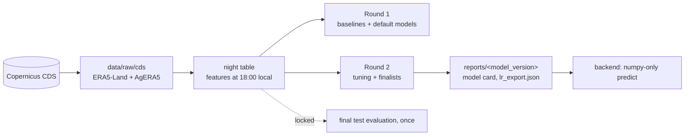

# altiplano-frost-alert

## Data notes

- Source: ERA5-Land reanalysis (Copernicus Climate Change Service, ECMWF), dataset `reanalysis-era5-land-timeseries` from the Copernicus Climate Data Store (CDS). Reanalysis combines a weather model with assimilated observations, including satellite data; it is not raw satellite imagery.
- One ERA5-Land grid cell (0.1 degree) per point. CDS area boxes appear to return the cells with S <= lat < N and W < lon <= E. This was inferred from two test requests and confirmed by a third, so each point uses the box [lat0 + 0.1, lon0 - 0.1, lat0, lon0] for its target cell (lat0, lon0), and the download checks that exactly that cell comes back.
- The choice of cell matters. In July 2025 near El Alto, the hours with 2 m temperature at or below 0 C were 92, 66, 68 and 13 in four neighboring cells.
- Cloud cover comes from a second product, AgERA5 (daily agrometeorological indicators derived from ERA5, Copernicus CDS), requested for each point's real coordinates. AgERA5 has its own 0.1 degree grid, possibly offset from the ERA5-Land cell by up to about 7 km. Its cloud cover is a 24 hour mean over the whole local day, so the night that starts on day D only uses the value of day D-1.
- AgERA5's night minimum temperature is used only to cross-check the frost label in the EDA, never as a model feature. Its value for date D covers the night that ends on the morning of D.
- Leakage controls: features use only hours up to 18:00 local of the night (22:00 UTC), cloud cover enters with a one-day lag, every fitted statistic uses training years only, and the test years (2018-2025) are locked until a single final evaluation. `make test` runs the checks.
- The model is valid only for the 8 cells listed in configs/points.yaml.
- 2026 data (up to late October) is kept out of training, validation and test. It is only an out-of-sample check and a source of nights for the replay and the manual tick.

## Data and experiments (DVC + DagsHub)



The data is ERA5-Land and AgERA5 reanalysis (a weather model combined with assimilated observations), not raw satellite imagery, and the frost labels come from the same reanalysis.

**What lives where**

| in git | in DagsHub (DVC remote and MLflow) |
|---|---|
| code (`src/frostwatch_ml`, `pipelines/`, `tests/`, `tools/`), configs, docs, executed notebooks | raw CDS downloads (`dvc/raw_cds.dvc`) |
| `reports/`: validation tables, model cards, `lr_export.json`, thresholds, reliability bins, figures | `data/processed/`: night table, anomalies, cross-checks, validation predictions |
| `experiments/<run_id>/`: config and metrics of every run | `models/<model_version>/model.joblib` |
| `dvc.yaml`, `dvc.lock`, `.dvc/config` | MLflow runs: https://dagshub.com/SNARF3/altiplano-frost.mlflow (experiment "frostwatch-altiplano") |

DagsHub repository: https://dagshub.com/SNARF3/altiplano-frost

**Leakage controls** (checked by `make test`)

- Features use only hours up to 18:00 local (22:00 UTC) of the night; a test replaces every later value with noise and checks that no feature changes.
- Features are an explicit allowlist (`configs/features.yaml`); the label, identifiers and the AgERA5 cross-check columns can never be features.
- Cloud cover enters with a one-day lag (the AgERA5 daily mean includes hours after 18:00).
- Every fitted statistic (scaler, percentiles, climatology, calibration) uses training years (1985-2009) only; calibration uses a cross-validation grouped by year.
- Models, thresholds and hyperparameters are chosen on validation (2010-2017). The test years (2018-2025) are locked in code until a single final evaluation; 2026 is only an out-of-sample check.

**Reproduce**

```
python3.12 -m venv .venv
.venv/bin/pip install -r requirements.txt -r requirements-model.txt
.venv/bin/pip install -e .
dvc pull          # raw data, processed data and models from DagsHub
make test lint    # leakage and integrity tests, ruff
dvc repro         # rerun any stage whose code, config or inputs changed
```

Generated using Copernicus Climate Change Service information [2026].

## Future work

Future work: live forecast ingestion. The pipeline currently runs on CDS reanalysis, which is published a few days late, so there is no 'tonight' prediction yet. A forecast source such as the Open-Meteo forecast API could be added later, with care: its free tier is for non-commercial use and limited (about 10,000 weighted calls per day, 5,000 per hour and 600 per minute), a commercial deployment needs a paid plan, and its variables must match the training features (for example it does not provide downward longwave radiation, so that feature would have to be dropped or approximated).
