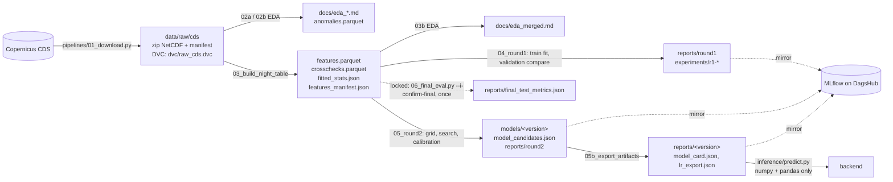

# ML module specification (frostwatch_ml)

Authoritative description of the ML module. Data: ERA5-Land hourly and AgERA5 daily reanalysis from the Copernicus Climate Data Store (not raw satellite imagery). Labels come from the same reanalysis.

## Data flow



## Module map (src/frostwatch_ml)

| module | role |
|---|---|
| config.py | paths, constants (UTC offset, seed), YAML loading, structured logging |
| dataio/manifest.py, cds_reader.py, tables.py | manifest verification; zip extraction into data/processed/scratch; atomic writes and hashes |
| prep/units.py, physics.py, quality.py | unit conversions; Magnus RH, sky emissivity, elevation proxy; EDA anomaly rules |
| features/snapshot.py, labels.py, cloud.py, fitted.py, night_table.py | 18:00 features; label window; AgERA5 lag 1; training-only statistics; table builder |
| splits.py | whole-year chronological split and its assertions |
| leakage.py | feature allowlist, deny patterns, test-set lock |
| models/ | common interface; baselines; logistic regression; trees; Platt calibration (year-grouped CV); registry |
| evaluation/ | metrics, F2 threshold on validation, per-cell and macro metrics, skill, report writers, plots, notebook helpers |
| runner.py | fit on train, threshold and metrics on validation, experiments/<run_id>/ records |
| tracking/ | MLflow mirror; DVC sync (one attempt, non-fatal) |
| artifacts/ | model bundle (joblib + meta), LR JSON export, model card |
| inference/predict.py | serve the LR export with numpy and pandas only |
| eda/ | Part 1 EDA reports |

Scripts in pipelines/ are thin CLIs (`--config`, `--seed`, `--dry-run`, `--no-sync`).

## Time convention

- Local time is UTC-4 with no daylight saving.
- Night D: the local date of the 18:00 snapshot, which is 22:00 UTC of D.
- Features: only hours at or before 22:00 UTC of D (15:00 local = 19:00 UTC; afternoon = hours ending 16:00 to 21:00 UTC; precipitation = 24 hours ending 22:00 UTC; previous night = 22:00 UTC of D-1 to 13:00 UTC of D). AgERA5 cloud cover of D-1 only.
- Label: frost = 1 if min hourly t2m from 22:00 UTC of D to 13:00 UTC of D+1 (16 values) <= 0 C.
- Split by calendar year of D: train 1985-2009, validation 2010-2017, test 2018-2025, out_of_sample_check 2026.

## Leakage matrix

| risk | control | test |
|---|---|---|
| features read hours after 18:00 | snapshot.py reads only hours <= 22:00 UTC | 1 (future perturbation, 3 cells x 30 nights) |
| label or ids used as features | explicit allowlist in configs/features.yaml, deny patterns | 2 |
| AgERA5 night minimum or RH 15:00 used as features | kept only in crosschecks.parquet | 3 |
| same-day cloud cover (includes hours after 18:00) | cloud.py uses D-1, joined by point and date | 4 |
| statistics fitted on non-training rows | fitted.py selects split == train; scaler inside the LR pipeline fitted on train rows | 5 |
| random or overlapping split; 2026 in modeling | splits.py whole years and assertions; code search for random splitters | 6 |
| test set used during development | leakage.model_rows refuses test; load_test_split needs a flag and pipelines/06_final_eval.py | 7 |
| thresholds or hyperparameters tuned on test or with random CV | best_f2_threshold(y_val, score_val); GroupKFold by year for calibration | 8 |
| features that encode time | name checks, correlation with year < 0.5, cell constants from training | 9 |
| non-reproducible results | seed 42, deterministic tree settings | 10 |
| refactor changes the data | content hash regression against Part 1 | 11 |
| serving differs from training | numpy export reproduces sklearn within 1e-9 | 12 |
| incomplete artifacts | required keys of bundle, card, export | 13 |
| logic hidden in notebooks | tools/check_notebooks.py | 14 |

## Artifact policy (git and DVC never share a folder's ownership)

| path | tracked by | content |
|---|---|---|
| data/raw/cds | DVC (dvc/raw_cds.dvc) | zip NetCDF, AgERA5 NetCDF, manifest |
| data/processed (including predictions/) | DVC (dvc.yaml outs) | night table, anomalies, cross-checks, fitted stats, candidates, validation predictions |
| models/<version>/ | DVC | model.joblib, bundle_meta.json |
| reports/ | git (small text and PNG) | tables, model cards, lr_export.json, thresholds, reliability bins, figures |
| experiments/<run_id>/ | git | config.yaml, metrics.json (source of truth); MLflow mirrors them |
| docs/, notebooks/, src/, pipelines/, tests/, tools/, configs/ | git | code and documentation |

Model version id: `<model>-<YYYYMMDD>-<datahash8>`, with the date fixed in configs/model.yaml and datahash = content hash of features.parquet. Validation predictions live in data/processed/predictions/<round>/<run_id>.csv (DVC) instead of experiments/, so that no folder mixes git and DVC files.

## Commands

```
make test        # pytest, 14 leakage and integrity tests
make lint        # ruff
make eda         # 02a, 02b, 03b
make features    # 03 night table
make round1      # 04
make round2      # 05 (and `make export` for 05b)
make notebooks   # build, execute, export, check
make repro       # dvc repro, then sync
make sync        # dvc status, push, status -c (one attempt each)
```
Pipeline scripts sync automatically at the end unless `--no-sync`; inside `dvc repro` they run with `--no-sync` and `make repro` syncs afterwards.

## Reproducibility

Seed 42 everywhere. data/raw is pinned by dvc/raw_cds.dvc, every stage by dvc.lock. Each experiment stores its config, data hash (content hash), features_manifest SHA-256 and package versions. Package versions are pinned in requirements-model.txt (mlflow 3.17.2 requires pyarrow < 26, so parquet files are written with pyarrow 25.0.1; content is identical to Part 1, file hashes differ only by the writer version stamp).

## Limitations

- Labels come from the same reanalysis as the features (grid frost, smoother than station frost).
- ERA5-Land cells are about 9 km; local terrain and cold air pooling are not resolved.
- AgERA5 has its own 0.1 degree grid (coincides with the ERA5-Land cells for these 8 points; can be offset by up to about 7 km in general).
- The cloud proxy is lagged by one day.
- Frost nights trend down over 1985-2025; test years have a lower base rate than training.
- Latitude and the elevation proxy are constants of the 8 cells: the model is valid only for these 8 cells.
- Reanalysis arrives a few days late; there is no live forecast input yet.
