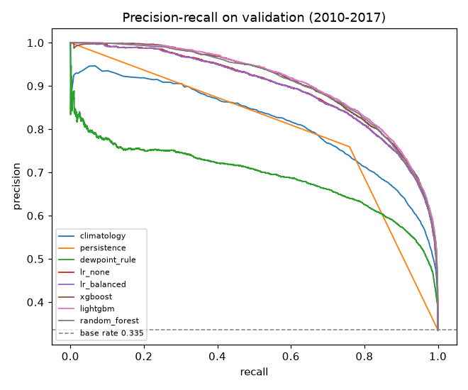

# Round 1: baselines and default models (validation only)

Generated by `pipelines/04_round1.py`. Train 1985-2009, validation 2010-2017; the test set (2018-2025) is locked and was not used. Every model is fitted on training rows; each decision threshold maximizes F2 on validation. Labels come from the same ERA5-Land reanalysis as the features (grid frost, not station frost).

Frost nights trend down over 1985-2025: the validation base rate is lower than in training, and the test base rate is lower still. Base rates also differ a lot between cells, so results are given pooled, per cell and as the macro-average over the 8 cells.

## Metrics in one sentence
- **accuracy**: Share of nights classified correctly; misleading alone because frost nights are a minority.
- **majority_class_accuracy**: Accuracy of always predicting the most frequent class in the same rows; accuracy must beat it.
- **precision**: Of the nights flagged as frost, the share that had frost (few false alarms means high precision).
- **recall**: Of the nights with frost, the share that was flagged (few missed frosts means high recall).
- **f1**: Harmonic mean of precision and recall.
- **f2**: Like F1 but weights recall four times more than precision, because a missed frost costs more than a false alarm.
- **roc_auc**: Probability that a random frost night gets a higher score than a random non-frost night (0.5 is chance).
- **pr_auc**: Average precision over all thresholds; its chance level is the base rate, so it is informative for rare events.
- **brier**: Mean squared error of the predicted probability (lower is better); defined only for probability scores.

Decision metrics: PR-AUC and F2. The dew point rule is a score, not a probability, so its Brier score is not defined. Persistence is a 0/1 forecast; its Brier score equals its error rate.

## Pooled (all validation nights)
| model | accuracy | majority_class_accuracy | precision | recall | f1 | f2 | roc_auc | pr_auc | brier | threshold | base_rate |
|---|---|---|---|---|---|---|---|---|---|---|---|
| majority | 0.3353 | 0.6647 | 0.3353 | 1.0000 | 0.5023 | 0.7161 | 0.5000 | 0.3353 | 0.2249 | 0.3807 | 0.3353 |
| climatology | 0.7593 | 0.6647 | 0.5869 | 0.9525 | 0.7263 | 0.8470 | 0.9078 | 0.8135 | 0.1195 | 0.2160 | 0.3353 |
| persistence | 0.8386 | 0.6647 | 0.7593 | 0.7594 | 0.7594 | 0.7594 | 0.8190 | 0.6573 | 0.1614 | 1.0000 | 0.3353 |
| dewpoint_rule | 0.7008 | 0.6647 | 0.5300 | 0.9525 | 0.6810 | 0.8215 | 0.8541 | 0.6903 |  | -1.2368 | 0.3353 |
| lr_none | 0.8138 | 0.6647 | 0.6510 | 0.9587 | 0.7754 | 0.8759 | 0.9426 | 0.8917 | 0.0914 | 0.1694 | 0.3353 |
| lr_balanced | 0.8234 | 0.6647 | 0.6656 | 0.9511 | 0.7832 | 0.8760 | 0.9426 | 0.8913 | 0.0972 | 0.2784 | 0.3353 |
| xgboost | 0.8347 | 0.6647 | 0.6825 | 0.9481 | 0.7937 | 0.8796 | 0.9479 | 0.9042 | 0.0883 | 0.1989 | 0.3353 |
| lightgbm | 0.8184 | 0.6647 | 0.6563 | 0.9625 | 0.7804 | 0.8804 | 0.9494 | 0.9070 | 0.0864 | 0.1622 | 0.3353 |
| random_forest | 0.8196 | 0.6647 | 0.6588 | 0.9582 | 0.7808 | 0.8783 | 0.9471 | 0.9011 | 0.0879 | 0.2200 | 0.3353 |

## Macro-average over the 8 cells
| model | accuracy | majority_class_accuracy | precision | recall | f1 | f2 | roc_auc | pr_auc | brier | base_rate |
|---|---|---|---|---|---|---|---|---|---|---|
| majority | 0.3353 | 0.6932 | 0.3353 | 1.0000 | 0.4851 | 0.6840 | 0.5000 | 0.3353 | 0.2249 | 0.3353 |
| climatology | 0.7593 | 0.6932 | 0.5661 | 0.9432 | 0.7037 | 0.8281 | 0.8914 | 0.7310 | 0.1195 | 0.3353 |
| persistence | 0.8386 | 0.6932 | 0.7176 | 0.7176 | 0.7176 | 0.7176 | 0.7932 | 0.6060 | 0.1614 | 0.3353 |
| dewpoint_rule | 0.7008 | 0.6932 | 0.5124 | 0.9496 | 0.6526 | 0.7952 | 0.8574 | 0.6642 |  | 0.3353 |
| lr_none | 0.8138 | 0.6932 | 0.6224 | 0.9576 | 0.7471 | 0.8572 | 0.9358 | 0.8372 | 0.0914 | 0.3353 |
| lr_balanced | 0.8234 | 0.6932 | 0.6361 | 0.9488 | 0.7547 | 0.8573 | 0.9357 | 0.8362 | 0.0972 | 0.3353 |
| xgboost | 0.8347 | 0.6932 | 0.6517 | 0.9416 | 0.7653 | 0.8600 | 0.9401 | 0.8508 | 0.0883 | 0.3353 |
| lightgbm | 0.8184 | 0.6932 | 0.6265 | 0.9587 | 0.7519 | 0.8610 | 0.9421 | 0.8574 | 0.0864 | 0.3353 |
| random_forest | 0.8196 | 0.6932 | 0.6287 | 0.9544 | 0.7523 | 0.8592 | 0.9397 | 0.8470 | 0.0879 | 0.3353 |

## Skill against the best baseline
Difference in PR-AUC and F2 against the better of climatology and persistence, and Brier skill score against climatology (1 - Brier / Brier_climatology).

Pooled:

| model | pr_auc | pr_auc_minus_best_baseline | f2 | f2_minus_best_baseline | brier_skill_vs_climatology |
|---|---|---|---|---|---|
| majority | 0.3353 | -0.4781 | 0.7161 | -0.1309 | -0.8824 |
| climatology | 0.8135 | 0.0000 | 0.8470 | 0.0000 | 0.0000 |
| persistence | 0.6573 | -0.1562 | 0.7594 | -0.0876 | -0.3507 |
| dewpoint_rule | 0.6903 | -0.1232 | 0.8215 | -0.0255 |  |
| lr_none | 0.8917 | 0.0782 | 0.8759 | 0.0289 | 0.2354 |
| lr_balanced | 0.8913 | 0.0778 | 0.8760 | 0.0290 | 0.1868 |
| xgboost | 0.9042 | 0.0907 | 0.8796 | 0.0326 | 0.2608 |
| lightgbm | 0.9070 | 0.0935 | 0.8804 | 0.0333 | 0.2774 |
| random_forest | 0.9011 | 0.0876 | 0.8783 | 0.0313 | 0.2648 |

Macro:

| model | pr_auc | pr_auc_minus_best_baseline | f2 | f2_minus_best_baseline | brier_skill_vs_climatology |
|---|---|---|---|---|---|
| majority | 0.3353 | -0.3956 | 0.6840 | -0.1442 | -0.8824 |
| climatology | 0.7310 | 0.0000 | 0.8281 | 0.0000 | 0.0000 |
| persistence | 0.6060 | -0.1250 | 0.7176 | -0.1105 | -0.3507 |
| dewpoint_rule | 0.6642 | -0.0668 | 0.7952 | -0.0329 |  |
| lr_none | 0.8372 | 0.1062 | 0.8572 | 0.0291 | 0.2354 |
| lr_balanced | 0.8362 | 0.1052 | 0.8573 | 0.0292 | 0.1868 |
| xgboost | 0.8508 | 0.1198 | 0.8600 | 0.0319 | 0.2608 |
| lightgbm | 0.8574 | 0.1265 | 0.8610 | 0.0329 | 0.2774 |
| random_forest | 0.8470 | 0.1160 | 0.8592 | 0.0311 | 0.2648 |

## Per cell: validation base rate, PR-AUC and F2
| point_id | validation_base_rate |
|---|---|
| calamarca | 0.342 |
| caracollo | 0.202 |
| charana | 0.614 |
| corocoro | 0.490 |
| el_alto | 0.162 |
| huanuni | 0.357 |
| oruro | 0.193 |
| patacamaya | 0.323 |

| point_id | climatology | dewpoint_rule | lightgbm | lr_balanced | lr_none | majority | persistence | random_forest | xgboost |
|---|---|---|---|---|---|---|---|---|---|
| calamarca | 0.797 | 0.764 | 0.879 | 0.868 | 0.868 | 0.342 | 0.640 | 0.873 | 0.875 |
| caracollo | 0.595 | 0.434 | 0.754 | 0.706 | 0.708 | 0.202 | 0.439 | 0.736 | 0.753 |
| charana | 0.890 | 0.897 | 0.967 | 0.960 | 0.960 | 0.614 | 0.820 | 0.965 | 0.966 |
| corocoro | 0.865 | 0.860 | 0.949 | 0.939 | 0.939 | 0.490 | 0.767 | 0.948 | 0.948 |
| el_alto | 0.517 | 0.451 | 0.719 | 0.666 | 0.670 | 0.162 | 0.388 | 0.701 | 0.697 |
| huanuni | 0.803 | 0.718 | 0.929 | 0.914 | 0.914 | 0.357 | 0.703 | 0.915 | 0.924 |
| oruro | 0.600 | 0.492 | 0.781 | 0.767 | 0.767 | 0.193 | 0.467 | 0.757 | 0.763 |
| patacamaya | 0.781 | 0.697 | 0.882 | 0.871 | 0.871 | 0.323 | 0.624 | 0.881 | 0.881 |

| point_id | climatology | dewpoint_rule | lightgbm | lr_balanced | lr_none | majority | persistence | random_forest | xgboost |
|---|---|---|---|---|---|---|---|---|---|
| calamarca | 0.862 | 0.814 | 0.875 | 0.873 | 0.875 | 0.722 | 0.743 | 0.873 | 0.877 |
| caracollo | 0.782 | 0.720 | 0.820 | 0.819 | 0.814 | 0.559 | 0.598 | 0.818 | 0.825 |
| charana | 0.891 | 0.916 | 0.931 | 0.931 | 0.931 | 0.888 | 0.855 | 0.933 | 0.935 |
| corocoro | 0.867 | 0.881 | 0.918 | 0.902 | 0.903 | 0.828 | 0.826 | 0.910 | 0.912 |
| el_alto | 0.727 | 0.711 | 0.757 | 0.765 | 0.758 | 0.491 | 0.564 | 0.759 | 0.756 |
| huanuni | 0.864 | 0.843 | 0.895 | 0.891 | 0.890 | 0.735 | 0.793 | 0.889 | 0.887 |
| oruro | 0.777 | 0.677 | 0.824 | 0.810 | 0.819 | 0.544 | 0.629 | 0.821 | 0.819 |
| patacamaya | 0.854 | 0.799 | 0.868 | 0.867 | 0.866 | 0.705 | 0.733 | 0.870 | 0.869 |

No confidence intervals are computed; small differences may be noise.
